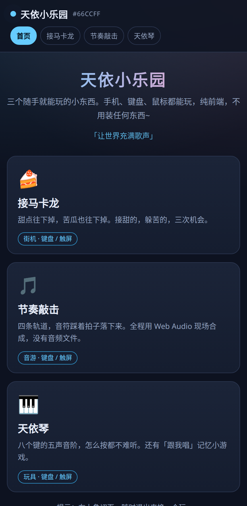
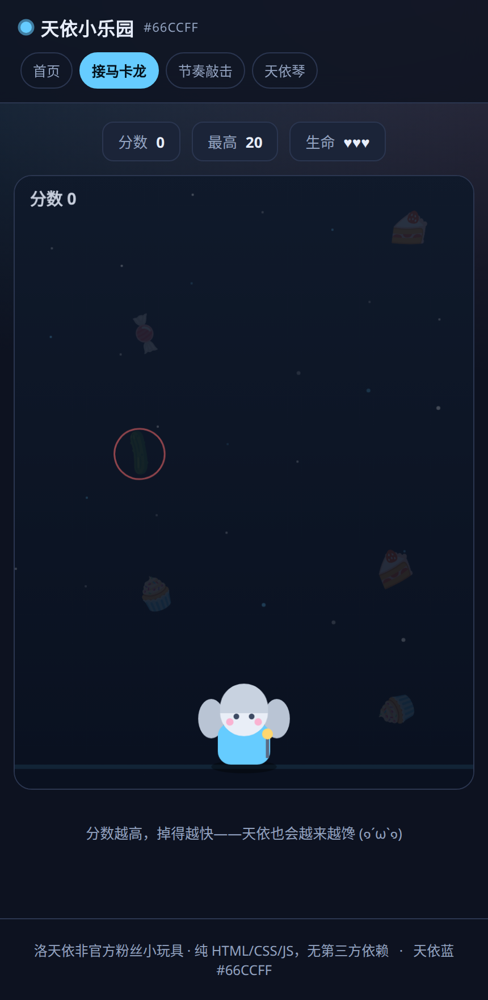
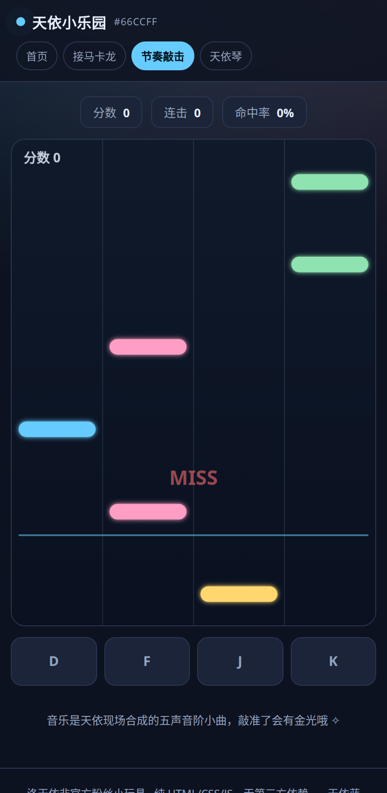
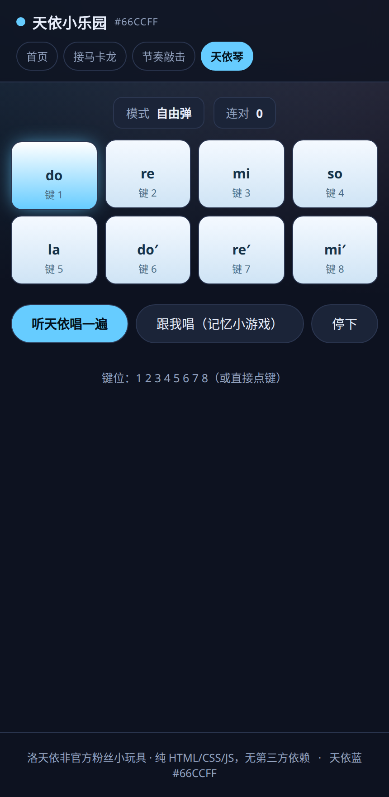

# 天依小乐园 · Luo Tianyi Playground

洛天依主题的小游戏乐园，三个随手就能玩的小东西。**纯 HTML / CSS / JavaScript，零第三方依赖、零构建步骤、零音频文件。**

🔗 在线玩：<https://haufionect.github.io/tianyi-playground/>

## 三个小游戏

| 游戏 | 玩法 | 操作 |
| --- | --- | --- |
| 🍰 接马卡龙 | 接住掉下来的甜点，躲开苦瓜，三条命，最高分存在 localStorage | `←` `→` / `A` `D` / 触屏拖动 |
| 🎵 节奏敲击 | 四轨道音游，音符落到判定线时敲下去，判定 PERFECT / GOOD / MISS | `D` `F` `J` `K` / 点下方轨道 |
| 🎹 天依琴 | 八键五声音阶，自由弹；「跟我唱」记忆小游戏一关一关变长 | `1`–`8` / 点琴键 |

## 截图

| 首页 | 接马卡龙 | 节奏敲击 | 天依琴 |
| --- | --- | --- | --- |
|  |  |  |  |

## 技术小记

- **音乐全是现场合成的。** `js/audio.js` 里是一个很薄的 Web Audio 封装（振荡器 + 包络 + 十二平均律音高换算），音游的旋律与低音、琴的音色、命中的提示音都是运行时算出来的，仓库里没有任何 `.mp3` / `.wav`。
- **节奏游戏用「前瞻调度 + 音频时钟」**：`setInterval` 每 25ms 把未来 0.4s 内的音符排进 Web Audio 的时间轴，画面位置则按 `AudioContext.currentTime` 反推，所以音符和声音是同一个时钟，不会各跑各的。
- **街机游戏用 rAF + 最大帧间隔钳制**（`dt` 上限 50ms），切走标签页回来不会因为时间跳变而瞬移。
- **`roundRect` 有兜底**，老一点的移动端浏览器也能画圆角音符。
- 每个游戏都挂了一个 `debug()` 小窗口（`TYGames.macaron.debug()` 等），方便自动化测试读内部状态，不影响游戏本身。

## 本地跑起来

静态站点，不需要构建：

```bash
python3 -m http.server 8899
# 然后打开 http://127.0.0.1:8899/
```

或者直接双击 `index.html`（`file://` 也能玩，Web Audio 需要你先点一下页面）。

## 说明

非官方粉丝作品，与上海禾念 / VOCALOID 官方无关，仅供学习与娱乐。天依蓝 `#66CCFF`。
